<p align="center">
  
</p>

<h1 align="center">ChartShelf</h1>

<p align="center">
  Fast, dependency-free SVG charts for the browser.<br>
  MIT licensed. No build step. No runtime dependencies.
</p>

<p align="center">
  <a href="#gallery">Gallery</a>
  &nbsp;·&nbsp;
  <a href="#install">Install</a>
  &nbsp;·&nbsp;
  <a href="#quick-start">Quick start</a>
  &nbsp;·&nbsp;
  <a href="#options">Options</a>
  &nbsp;·&nbsp;
  <a href="#license">License</a>
</p>

<p align="center">
  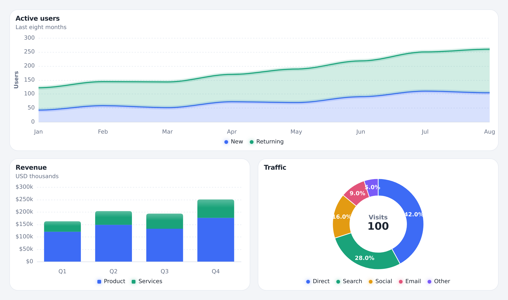
</p>

ChartShelf draws the charts in a product dashboard: time series, stacked areas and columns, mixed columns and lines, extra value axes, donuts, and radial gauges. Each chart is one SVG. A line or an area is one path, so a hover, a zoom, or a theme change updates that picture in place.

Pass a plain options object to a constructor, or call the matching helper. Types ship in `chartshelf.d.ts`.

## Gallery

<p align="center">
  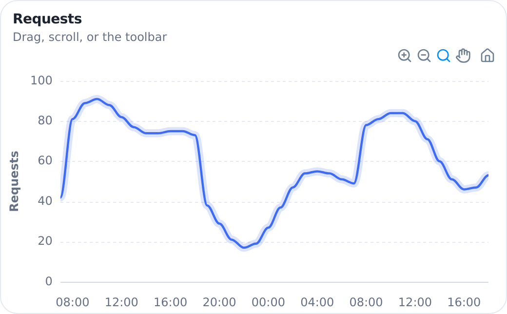
  &nbsp;
  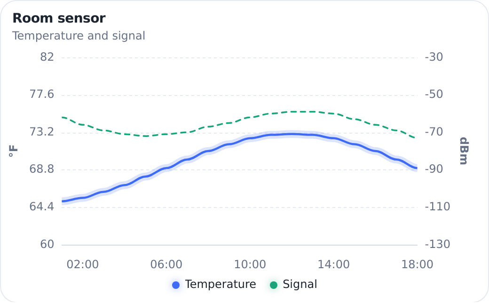
</p>
<p align="center">
  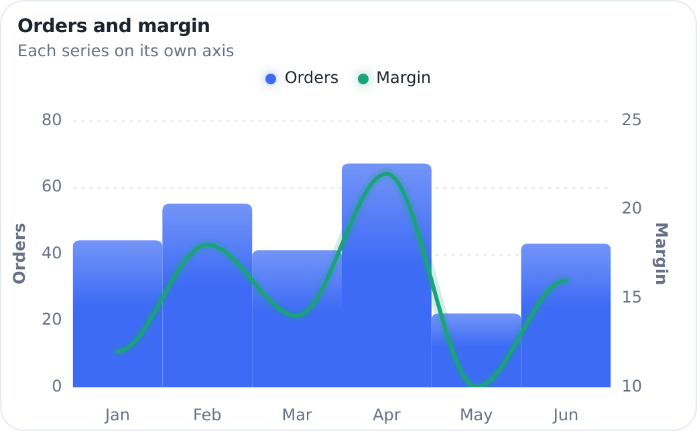
  &nbsp;
  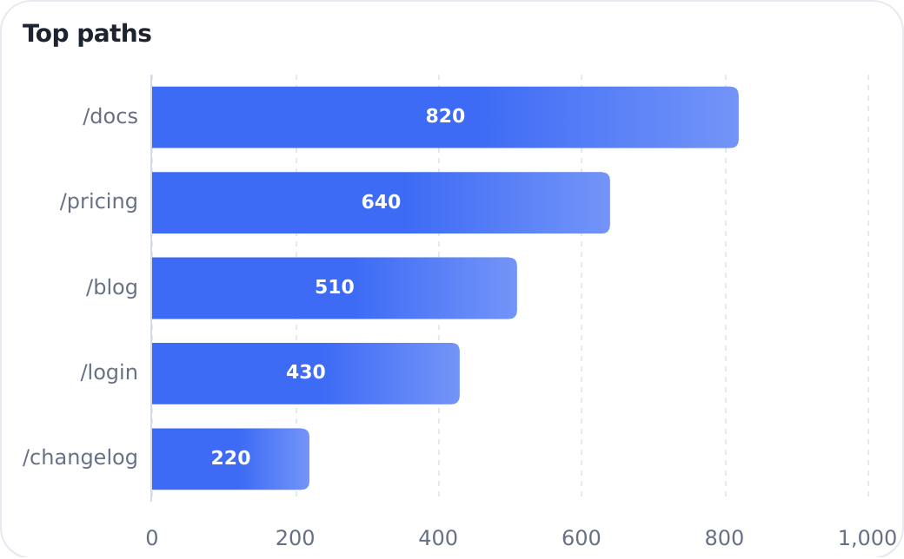
</p>
<p align="center">
  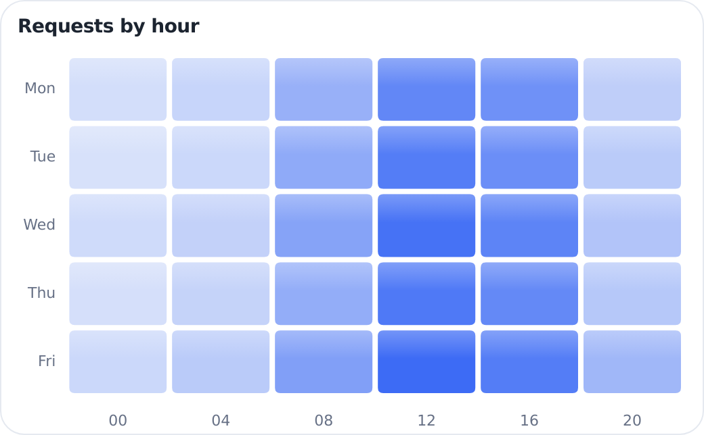
  &nbsp;
  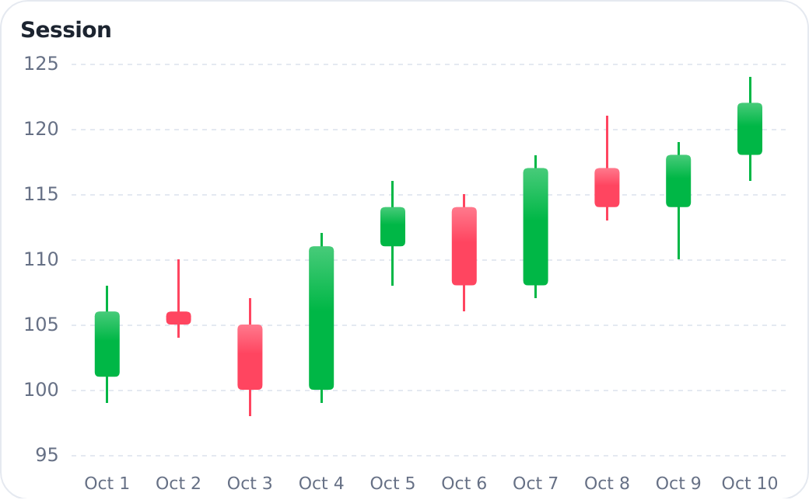
</p>
<p align="center">
  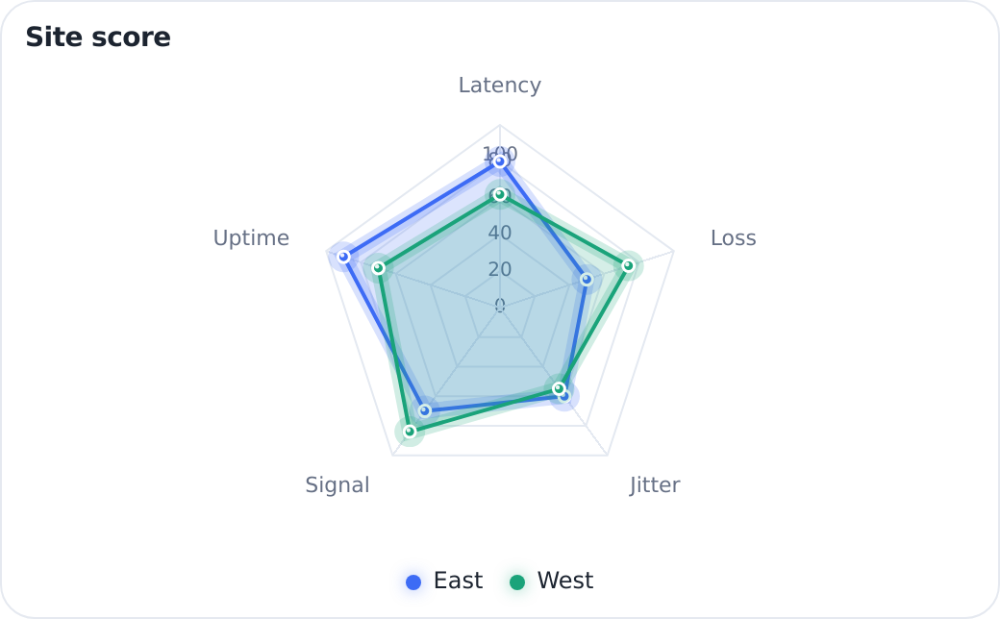
  &nbsp;
  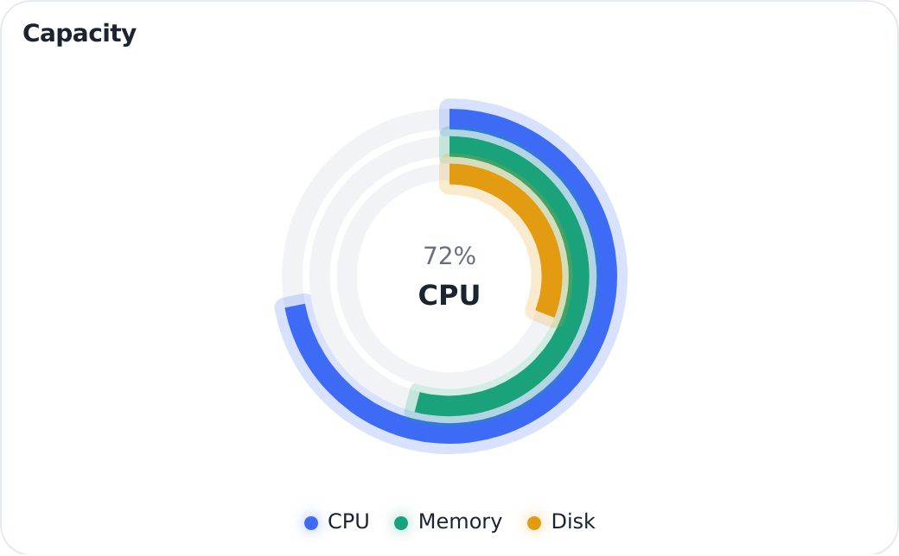
</p>
<p align="center">
  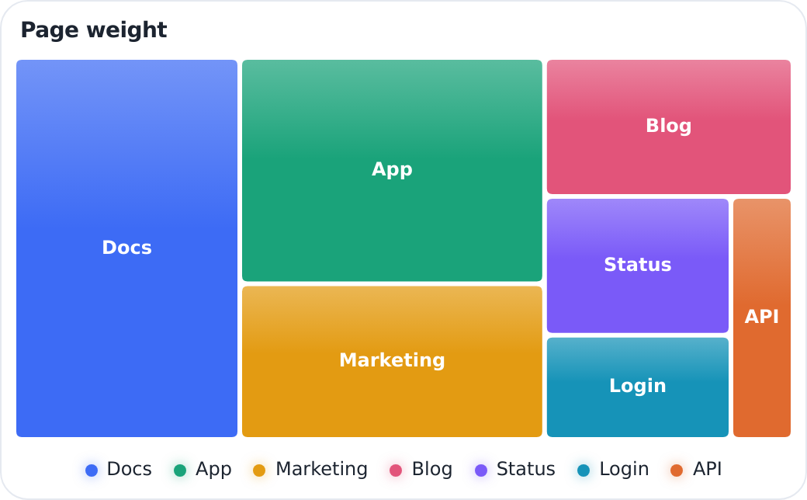
  &nbsp;
  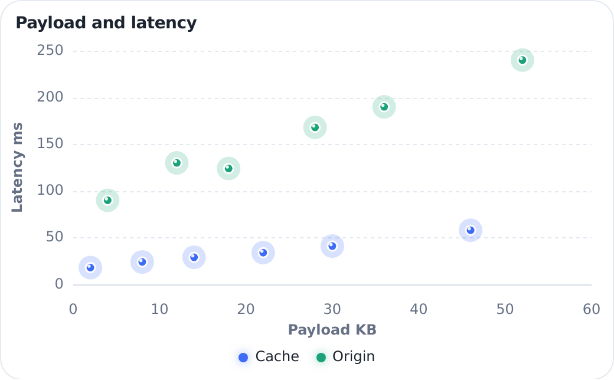
</p>

The same options cover pie, column, box plot, range bar, range area, polar area, and sparklines. The gallery in [`demo/index.html`](demo/index.html) draws them all.

## Install

The package entry is `src/index.js`. Install from a checkout of this repository:

```bash
npm install /path/to/chartshelf
```

```js
import { area, line } from 'chartshelf';
```

A page can import the module directly. Serve the page over HTTP. Module imports do not run from a `file://` address.

```html
<div id="users"></div>
<script type="module">
  import { area } from './src/index.js';

  area('#users', {
    categories: ['Mon', 'Tue', 'Wed'],
    series: { New: [12, 18, 15], Returning: [8, 9, 11] },
    stacked: true,
  });
</script>
```

```bash
npm run demo
```

Then open `/demo/index.html`.

## Quick start

This is the area chart in the picture above.

```js
import { area } from 'chartshelf';

area('#users', {
  title: 'Active users',
  subtitle: 'Last eight months',
  categories: ['Jan', 'Feb', 'Mar', 'Apr', 'May', 'Jun', 'Jul', 'Aug'],
  series: {
    New: [42, 58, 51, 72, 69, 90, 110, 104],
    Returning: [80, 86, 92, 98, 120, 128, 140, 156],
  },
  stacked: true,
});
```

`area()` draws immediately and returns the chart. `new Area(element, config)` is the same chart and waits for `render()`.

```js
import { Line } from 'chartshelf';

const chart = new Line(document.querySelector('#revenue'), {
  title: 'Monthly revenue',
  categories: ['Jan', 'Feb', 'Mar', 'Apr', 'May', 'Jun', 'Jul'],
  series: { Revenue: [30, 40, 35, 50, 49, 60, 70] },
  y: { title: 'Revenue', format: (value) => `$${value}` },
  curve: 'smooth',
});

chart.render();
chart.updateSeries({ Revenue: [32, 44, 40, 51, 49, 62, 74] });
chart.update({ strokeWidth: 3 });
```

Every kind has both forms.

| Constructor | Helper |
| --- | --- |
| `Line` | `line` |
| `Area` | `area` |
| `Bar` | `bar` |
| `Column` | `column` |
| `HorizontalBar` | `horizontalBar` |
| `Pie` | `pie` |
| `Donut` | `donut` |
| `Scatter` | `scatter` |
| `Radar` | `radar` |
| `Heatmap` | `heatmap` |
| `Treemap` | `treemap` |
| `Candlestick` | `candlestick` |
| `BoxPlot` | `boxPlot` |
| `RangeBar` | `rangeBar` |
| `RangeArea` | `rangeArea` |
| `PolarArea` | `polarArea` |
| `RadialBar` | `radialBar` |

`new ChartShelf(element, config)` is the general constructor. Set `type` when the kind is chosen at runtime. In the browser that constructor is also `window.ChartShelf`, and `window.ChartShelf.Line` is the line constructor.

A series on a mixed chart can set its own `type` (`column`, `line`, `area`, `bar`, or `scatter`), `dash`, and `yIndex`. Each entry in `yAxes` is a value axis. `opposite: true` draws it on the right. `show: false` keeps the scale and hides the labels.

## Series data

`series` accepts whichever shape is closest to the data you already have.

```js
line('#c', { series: [4, 8, 6, 11] });

bar('#c', { series: { Mon: 12, Tue: 18, Wed: 9 } });

pie('#c', { series: { Direct: 62, Search: 21, Social: 17 } });

line('#c', {
  categories: ['Mon', 'Tue', 'Wed'],
  series: [
    { name: 'New', data: [12, 18, 15], color: '#1aa37a' },
    { name: 'Returning', data: [8, 9, 11] },
  ],
});

scatter('#c', {
  series: { Trial: [[1, 20], [4, 35], [9, 28]] },
  x: { title: 'Size' },
  y: { title: 'Latency' },
});
```

`null` opens a gap in a line. Pairs of `[x, y]`, or `{ x, y }`, switch that series to a linear or time axis. Timestamps in milliseconds and `Date` values are time.

Rows work too. String columns become categories, and numeric columns become series.

```js
bar('#revenue', {
  data: [
    { month: 'Jan', revenue: 120, cost: 80 },
    { month: 'Feb', revenue: 140, cost: 90 },
  ],
  y: { title: 'USD thousands' },
});
```

Set `xKey`, `yKeys`, and `groupKey` when the guess is wrong.

```js
line('#regions', {
  data: rows,
  xKey: 'quarter',
  yKeys: 'value',
  groupKey: 'region',
});
```

`categories` and `labels` are the same option.

## Update and remove

`update` merges into the current config. `series` replaces the series. `x`, `y`, `legend`, and `grid` merge one level deep. A legend choice stays when the series name stays the same.

```js
const users = area('#users', { series: { New: [12, 18, 15] } });

users.update({
  categories: ['Mon', 'Tue', 'Wed', 'Thu'],
  series: { New: [12, 18, 15, 21] },
});

users.updateSeries({ New: [12, 18, 16, 24] });
users.destroy();
```

Same-length updates animate. `animate: false` draws the next frame immediately. `prefers-reduced-motion` does the same.

| Method | What it does |
| --- | --- |
| `render()` | Draw the chart |
| `update(config, animate?)` | Merge a partial config and redraw |
| `updateSeries(series)` | Replace the series |
| `setRange(min, max)` | Show an x window, in the same units as the data |
| `resetRange()` | Clear that window |
| `zoomBy(factor)` | Zoom around the middle of the window. A factor below 1 zooms in |
| `destroy()` | Remove the chart and its listeners |
| `Chart.lookup(id)` | The chart created with this `id` |

Click a point, bar, or slice with `onPoint`.

```js
bar('#paths', {
  horizontal: true,
  series: { Docs: 80, Pricing: 54, Blog: 31 },
  onPoint(event) {
    console.log(event.label, event.points);
  },
});
```

## Zoom, brush, and annotations

`zoom: true` turns on drag-to-window, wheel zoom around the pointer, shift-drag pan, double-click reset, and the window controls: zoom in, zoom out, selection, pan, and reset.

```js
const end = new Date(2026, 9, 8, 18, 0).getTime();
const points = Array.from({ length: 36 }, (_, i) => {
  const clock = new Date(end - (35 - i) * 3600000).getHours();
  const day = clock >= 8 && clock <= 18 ? 28 : 0;
  return [end - (35 - i) * 3600000, 42 + day + Math.round(16 * Math.sin(i / 3))];
});

line('#timeline', {
  id: 'traffic',
  title: 'Requests',
  zoom: true,
  markers: false,
  series: [{ name: 'Requests', data: points }],
  x: { format: 'HH:mm' },
  y: { zero: false },
});

area('#overview', {
  height: 132,
  legend: false,
  brush: { target: 'traffic' },
  series: [{ name: 'Requests', data: points }],
});
```

Dragging the overview calls `setRange` on the chart named by `brush.target`. An unpinned time or linear y axis refits to the points in the window. `y.refit: false` keeps the value scale. A category chart keeps its value scale and stretches the visible categories.

Annotations take `yaxis`, `xaxis`, and `points`. Each item keeps `y` or `x`, `borderColor` or `color`, and `label.text`. A point also accepts `marker.fillColor`.

```js
line('#latency', {
  categories: ['Mon', 'Tue', 'Wed', 'Thu', 'Fri'],
  series: { Gateway: [82, 96, null, 118, 101] },
  annotations: {
    yaxis: [{ y: 70, borderColor: '#e2547a', label: { text: 'Limit' } }],
  },
});
```

## Theme

`theme` is `light`, `dark`, or `auto`. `auto` follows the operating system. `chart.update({ theme: 'dark' })` repaints.

<p align="center">
  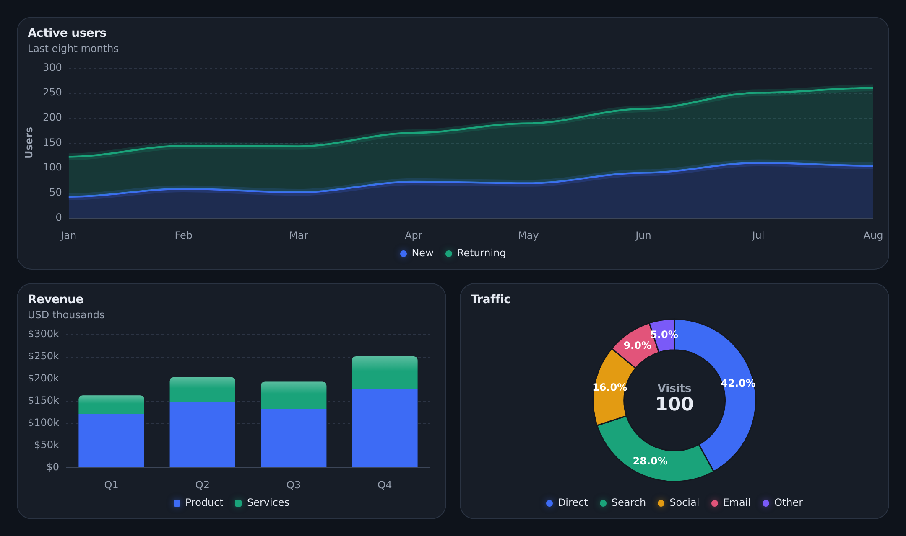
</p>

`responsive` overrides the config when the host is no wider than `maxWidth`.

```js
responsive: [{ maxWidth: 768, height: 340, legend: { position: 'bottom' } }]
```

The root SVG has the class `csh-svg`. `sparkline: true` hides the axes, the grid, and the legend.

## Options

| Option | Default | What it does |
| --- | --- | --- |
| `type` | `line` | Any constructor kind, when using `ChartShelf` |
| `height` | `320` | Pixels, or a CSS length such as `'100%'` |
| `width` | fill | Pixels or a CSS length |
| `title`, `subtitle` | none | Drawn above the plot |
| `stacked` | `false` | Stack area, line, or bar series. Negatives stack on their own side of zero |
| `stackType` | `'normal'` | `'100%'` scales each stack to the share of that category |
| `horizontal` | `false` | Bar charts. `horizontalBar` sets this |
| `curve` | `smooth` | `smooth`, `straight`, or `stepline`. Smooth keeps a level tangent through each sample |
| `colors` | built-in palette | One color per series. Also `series[].color` |
| `strokeWidth` | `2.25` | Line thickness |
| `fillOpacity` | `0.2` | Area fill |
| `markers` | `auto` | `true`, `false`, or `auto` (markers on short lines) |
| `dash` | solid | Stroke pattern. A number is that many pixels on and off, or pass one pattern per series |
| `legend` | on when needed | `false`, or `{ position: 'top' \| 'bottom' \| 'right' \| 'left' }` |
| `grid` | horizontal | `false`, or `{ x: true, y: false }` |
| `tooltip` | `true` | Shared tooltip |
| `axes` | `true` | `false` draws only the marks |
| `sparkline` | `false` | Hides axes, grid, and legend |
| `theme` | `auto` | `light`, `dark`, or the OS color scheme |
| `yAxes` | one axis | Extra value axes. A series selects one with `yIndex` |
| `y.zero` | on for bar and area | Keep zero on the value axis |
| `y.min`, `y.max` | from the data | Lock the value scale |
| `y.refit` | `true` | `false` keeps a time or linear value scale while the x window changes |
| `y.format` | compact number | `(value) => string` |
| `x.type` | guessed | `category`, `linear`, or `time` |
| `x.format` | number or date | `(value) => string`, or a time pattern such as `dd MMM HH:mm` |
| `x.utc` | `false` | Format time ticks in UTC |
| `showValues` | on for pie | Print values on bars, or percents on slices |
| `barRadius` | `5` | Rounded outer end of a bar |
| `inner` | `0.62` on donuts | Hole size, as a fraction of the radius. Radial tracks default to `0.42` |
| `gap` | `0` | Space between pie and donut slices, in pixels |
| `start`, `end` | full ring | Radial arc in degrees. 0 is 12 o'clock, clockwise |
| `center` | the total | Donut or radial label. A string is one line. `{ label, value }` draws the caption above the value. `false` hides a donut center |
| `zoom` | `false` | Drag, wheel, or the window controls zoom the x axis |
| `id`, `brush` | none | `brush.target` names the chart a drag should window |
| `annotations` | none | `yaxis`, `xaxis`, and `points` |
| `background` | transparent | Chart background |
| `animate` | `true` | Tween to the next values |
| `onPoint` | none | Called with the point, bar, or slice under the pointer |
| `responsive` | none | `{ maxWidth, ...config }` applied while the host is that narrow |

## Develop

```bash
npm test
```

Tests cover scales, stacking, curves, and geometry. `test/browser.test.js` loads the gallery in a browser. Rendering itself needs a browser.

## License

ChartShelf is [MIT licensed](LICENSE). Copyright (c) 2026 ChartShelf contributors.

You can use it in a commercial product, modify it, and distribute it. The MIT grant includes sale. Copies and substantial portions keep the copyright notice and the permission notice from [LICENSE](LICENSE).

This repository is an original implementation. Those MIT terms are the license that applies to it.
